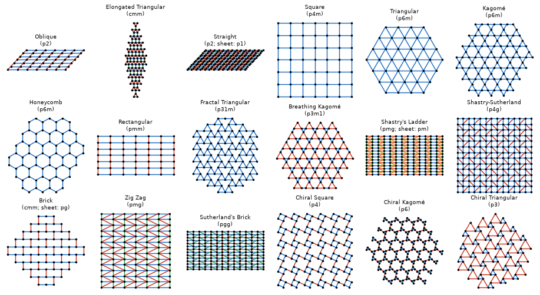
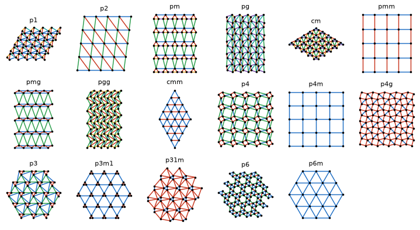
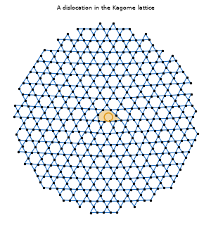

# papertilling

Planar periodic lattices of the 17 wallpaper (plane) groups, and the crystalline defects they carry.

For each wallpaper group the package lists the "most Bravais-like" lattices: a Bravais lattice is one point copied by translations, so every site is equivalent; here the sites are copied by the whole group, with as few kinds of site and as few sites per cell as the group allows (three precise rules are given below). For one lattice it lists every class of defect that breaks its crystalline symmetry (dislocations, disclinations, domain walls, twin walls, Moebius seams, glide-breaking walls) and builds crystals that contain chosen defects.



The first lattice of each of the 17 groups (stored list, rule `points`):



## Install

Python 3.10 or newer. From GitHub:

    pip install git+https://github.com/antimajorana/papertilling

From a clone of the repository:

    git clone https://github.com/antimajorana/papertilling
    cd papertilling
    pip install .

Extras (add them in brackets, for example `pip install ".[fast,widgets]"`):

| extra | adds | used for |
|---|---|---|
| `fast` | numba | faster lattice search (there is a slower pure-Python path without it) |
| `widgets` | ipywidgets | `explore(L)`, the sliders for the free parameters of a lattice |
| `notebooks` | jupyterlab, ipywidgets, numba | running the notebooks |
| `test` | pytest | running the tests |
| `all` | all of the above | |

The required packages are numpy, scipy, networkx, matplotlib and spglib.

## Quick start

```python
import papertilling as pt

cat = pt.load_catalogue()          # stored lists for all 17 groups (rule "points")
cat["p4g"].show()                  # table and pictures of the lattices of group p4g

L = pt.named("Kagomé")             # one of the 18 named lattices
L.plot()                           # draw it
L.group                            # 'p6m'

dc = pt.DefectCatalogue(L)         # every defect class of this lattice
dc.summary()                       # printed list: dislocations, disclinations, walls

b = dc.dislocations[0]["b"]        # Burgers vector of the first dislocation class
conf = pt.build(L, dict(kind="dislocation", b=b, at=(0.37, 0.41)))   # a crystal with that dislocation
conf.plot()
```

`load_catalogue()` reads stored lists (about 1 s). To search instead: `pt.minimal_lattices("p6m", n=12)` (tens of seconds). In a script, call `matplotlib.pyplot.show()` to see the figures.

## The three rules

A "lattice" here is a set of sites in the plane, repeated periodically, with bonds between them. `load_catalogue(rule=...)` and `minimal_lattices(group, n, rule=...)` rank the lattices of a wallpaper group in one of three ways:

- **`points`** (default). The points alone, with no bonds drawn, must have exactly the symmetry of the group, no more. Lattices with the fewest kinds of site come first, then the fewest sites per cell. The bonds are not chosen: two sites are joined when their Voronoi cells share an edge. Two lattices that give the same network (the same tiling when the symmetry is forgotten) count once.
- **`sheet`**. The same condition on the points, but the bonds are chosen: the fewest kinds of bond that give a planar, connected lattice with at least 3 bonds at every site. Rank: kinds of site, kinds of bond, sites per cell, bonds per cell. This rule reproduces a hand-made sheet of well-known lattices (the named lattices below).
- **`bonds`**. As `sheet`, without the condition on the points: the bonds may lower the symmetry below that of the points.

For p1, pm, pg and cm no lattice with one kind of site exists under the first two rules: a single orbit of points of these groups always has an extra 2-fold rotation.

A "kind" of site or bond is an orbit under the group.

## Named lattices

`pt.named_lattices()` lists 18 lattices taken from the hand-made sheet; `pt.named(name)` returns one, and `pt.gallery()` draws them all: Oblique, Elongated Triangular, Straight, Square, Triangular, Kagomé, Honeycomb, Rectangular, Fractal Triangular, Breathing Kagomé, Shastry's Ladder, Shastry-Sutherland, Brick, Zig Zag, Sutherland's Brick, Chiral Square, Chiral Kagomé, Chiral Triangular. Each entry records the group written on the sheet and the measured group of the drawing. Three drawings have more symmetry than their label (Straight is p2, Shastry's Ladder is pmg, Brick is cmm); the package also stores a deformed version of each that does have the labelled group (`straight_p1`, `shastrys_ladder_pm`, `brick_pg`).



## Notebooks

In `notebooks/` (they need the `notebooks` extra and a Jupyter kernel of the Python in which `papertilling` is installed):

1. `1. Lattices of a wallpaper group.ipynb`: the lattices of one group under a chosen rule, ITA Wyckoff tables, sliders for the free parameters.
2. `2. Defects of a lattice.ipynb`: every defect class of one lattice, with pictures.
3. `3. Defect configurations.ipynb`: several defects close together, compared by total charge and core graph.

## Tests and checks

    pip install ".[test,fast,widgets]"
    python -m pytest -q                      # default run: tests marked slow are skipped
    python -m pytest -q -m slow              # the heavy cases

Scripts to run by hand, from the repository root (see `docs/DEVELOPMENT.md`):

    python tools/checks/archimedean_control.py   # the search finds all 11 Archimedean tilings
    python tools/checks/catalogue_check.py       # every stored lattice is re-checked from its recipe
    python tools/checks/symmetry_check.py        # symmetry group of every stored drawing, by three routes

## What the results are, and are not

The lattice lists and defect classes are computational evidence, not proofs. Searches run only up to stated bounds: free parameters are sampled at a finite number of random values (48 per choice of sites for the rule `points`, 256 for the others), and the rules `sheet` and `bonds` only try bonds at most one cell long and at most 6 kinds of bond. The `coverage` and `bounds` attributes of a result state which bounds applied, and `open` lists lattices from tiers that were not finished. A lattice missing from a list may lie outside the bounds. The Archimedean check compares the search with a known answer (the 11 tilings), and the tests compare the fast code with the earlier engines; neither is a proof of completeness.

## More

`docs/DEVELOPMENT.md` describes the layout, the check scripts, how the stored data and notebooks are rebuilt, and the speed switches. `CHANGELOG.md` lists the versions.

## Licence

GPL-3.0-only. See `LICENSE`. Copyright (C) 2026 antimajorana.
