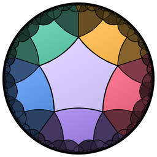

# Escher

Escher lets you build lattices and explore how their defects combine and bend a sheet. Its logo brings three curved faces together, with five, seven, and nine sides.

## Install

Run `*-windows-x86_64-setup.exe` on 64-bit Windows. The release also includes portable Windows, macOS, and Linux builds. [Latest downloads](https://github.com/antimajorana/Escher/releases/latest)

Every official desktop download and Python acceleration wheel includes `SOURCE-NOTICE.txt` with a link to its exact source revision. In a wheel, the notice and AGPL text are under `.dist-info/licenses/`. Each release also offers the matching source archives. [Escher releases](https://github.com/antimajorana/Escher/releases)

## Try it on the honeycomb

1. Use **Find lattice** to select **Honeycomb**. In **Defects → Fuse & compare**, choose **+α + −α → Dislocation**.
2. The pair has two local rotations of +60° and −60°. Its enclosing loop measures zero net rotation and a nonzero translation, the Burgers vector. Compare its pentagon–heptagon core with the single dislocation.
3. Choose **Open pair in Place & fuse**, then **Split view**. Set **Sheet colour** to **Angle deficit** to visualize curvature in the sheet model.

A match requires both the loop charge and the core bond pattern, within the search limits. [Scientific scope and mirror/glide examples](docs/SCIENTIFIC_SCOPE.md)

Open **View → Explore geometry** for 3D space groups and hyperbolic tilings. In **Hyperbolic H³**, start at layer 0 and increase **Layers** to grow the honeycomb. Browse 17 wallpaper groups and surface models under **Lattice**. Compare space, layer, and regular hyperbolic groups under **Advanced → All Views → Forge**.

## Python

Run `python -m pip install '.[notebooks]'` from this checkout with Python 3.10+, then open the worked notebooks.

[Notebooks](notebooks/) · [Build from source and run tests](docs/DEVELOPMENT.md#rust-core-desktop-app-and-optional-python-extension) · [Changelog](CHANGELOG.md) · [AGPL-3.0-only](LICENSE)

Escher is free software under the GNU Affero General Public License, version 3 only: you may use, study, share, and modify it under that licence. Anyone who runs a modified version as a network service must offer its source to that service's users.

Copyright © 2026 antimajorana
