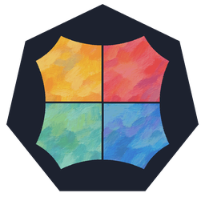

# Escher

Escher, formerly Papertilling, lets you build lattices and explore how their defects combine and bend a sheet. The logo shows four pentagons meeting at a vertex in the hyperbolic `{5,4}` tiling.

## Install

Run `*-windows-x86_64-setup.exe` on 64-bit Windows. The release also includes portable Windows, macOS, and Linux builds. [Latest downloads](https://github.com/antimajorana/papertilling/releases/latest)

## Try it on the honeycomb

1. Use **Find lattice** to select **Honeycomb**. In **Defects → Fuse & compare**, choose **+α + −α → Dislocation**.
2. The pair has two local rotations of +60° and −60°. Its enclosing loop measures zero net rotation and a nonzero translation, the Burgers vector. Compare its pentagon–heptagon core with the single dislocation.
3. Choose **Open pair in Place & fuse**, then **Split view**. Set **Sheet colour** to **Angle deficit** to visualize curvature in the sheet model.

A match requires both the loop charge and the core bond pattern, within the search limits. [Scientific scope and mirror/glide examples](docs/SCIENTIFIC_SCOPE.md)

Browse 17 wallpaper groups and surface models under **Lattice**. Compare space, layer, and regular hyperbolic groups under **Advanced → All Views → Forge**.

## Python

Run `python -m pip install .` from this checkout with Python 3.10+, then draw a honeycomb dislocation.

```python
import matplotlib.pyplot as plt
import papertilling as pt

lattice = pt.named("Honeycomb")
b = pt.DefectCatalogue(lattice).dislocations[0]["b"]
pt.build(lattice, dict(kind="dislocation", b=b, at=(0.37, 0.41))).plot()
plt.show()
```

[Notebooks](notebooks/) · [Build from source and run tests](docs/DEVELOPMENT.md#rust-core-desktop-app-and-optional-python-extension) · [Changelog](CHANGELOG.md) · [GPL-3.0-only](LICENSE)

Copyright © 2026 antimajorana
